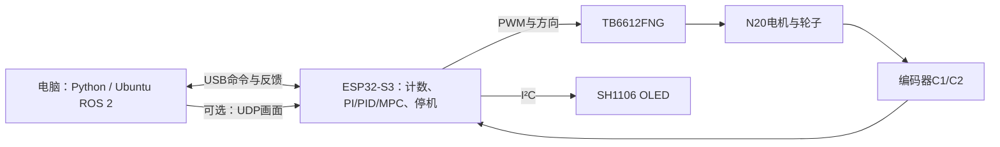

# ESP32 → ROS 2：从点亮 OLED 到约束 MPC

[](https://github.com/kaifeng0502/esp32-ros2-course/actions/workflows/ci.yml)
[](LICENSE)

一套按真实学习顺序整理的中文实践课程：**一块 ESP32-S3、一块 OLED、一个带编码器的电机**，从 USB 烧录、接线和排错开始，逐步做到 PI/PID、ROS 2 Action、RViz，再到电机辨识、板上 MPC 与预测转速约束。

课程包含 **21 节教程、逐节代码入口、两个独立入门固件、完整共用固件、ROS 2 工作区源码、离线测试，以及实机实验的转录数据和图表**。

## 先看这几件事

- [环境安装与快速开始](docs/setup.md)
- [硬件、供电与完整接线表](docs/hardware.md)
- [常见故障与排查顺序](docs/troubleshooting.md)
- [实机结果、数据来源与局限](docs/results.md)
- [代码结构、协议与阅读路线](docs/architecture.md)
- [对照实物理解PWM、PI/PID、位置与MPC](docs/control-principles.md)
- [对照项目理解ROS 2接口与数据流](docs/ros-concepts.md)

本课程的实机基线是 **ESP32-S3 N16R8 / ESP-IDF 5.5.6 / SH1106 128×64 / TB6612FNG / N20 双路编码器 / Ubuntu 24.04 + ROS 2 Jazzy**。编码器每路约1400边沿/车轮圈是这套硬件的校准结果，不是所有N20的通用参数。

## 按实验顺序学习

| 节 | 内容 | 代码与教程 |
|---:|---|---|
| 01 | 开发环境、USB、VS Code 与 Hello World | [开始](lessons/01-setup-usb/README.md) |
| 02 | OLED接线、SH1106、文字与中文位图 | [开始](lessons/02-oled-sh1106/README.md) |
| 03 | USB时间/剩余百分比屏、像素动画与帧协议 | [开始](lessons/03-usb-display/README.md) |
| 04 | Wi-Fi显示、配网、独立供电 | [开始](lessons/04-wifi-display/README.md) |
| 05 | 电机驱动、万用表、开环PWM | [开始](lessons/05-motor-pwm/README.md) |
| 06 | 编码器供电、共地、双路计数排错 | [开始](lessons/06-encoder-debug/README.md) |
| 07 | 每圈计数校准与实时RPM | [开始](lessons/07-calibration-rpm/README.md) |
| 08 | PI恒速、目标/时长、正反转、OLED反馈 | [开始](lessons/08-pi-speed/README.md) |
| 09 | 指定圈数/角度停止、减速与齿隙 | [开始](lessons/09-position/README.md) |
| 10 | 开环、P/PI/PID与控制性能比较 | [开始](lessons/10-control-comparison/README.md) |
| 11 | Ubuntu/UTM、ROS 2与USB权限 | [开始](lessons/11-ros-ubuntu/README.md) |
| 12 | Topic发布、目标订阅与实时曲线 | [开始](lessons/12-topics/README.md) |
| 13 | Service停止请求与硬件确认 | [开始](lessons/13-services/README.md) |
| 14 | Action目标、反馈、结果与取消 | [开始](lessons/14-actions/README.md) |
| 15 | Parameter配置如何传到硬件 | [开始](lessons/15-parameters/README.md) |
| 16 | Launch统一启动与退出 | [开始](lessons/16-launch/README.md) |
| 17 | rosbag记录、隔离回放与离线分析 | [开始](lessons/17-rosbag/README.md) |
| 18 | JointState、URDF、TF与RViz真实轮子跟随 | [开始](lessons/18-jointstate-rviz/README.md) |
| 19 | 二阶预测模型、辨识与独立验证 | [开始](lessons/19-identification/README.md) |
| 20 | 板上MPC/PID比较、优化权重与取舍 | [开始](lessons/20-mpc-comparison/README.md) |
| 21 | 预测转速约束、误差余量与实测验收 | [开始](lessons/21-constrained-mpc/README.md) |

每节有目标、准备、源码链接、实际运行命令、预期现象、排错与练习。前两节是独立 ESP-IDF 工程；第3节起共享根目录的完整固件，章节的 `code/` 提供运行入口，共用实现位于 `main/`、`host/`、`ros2/`，避免复制21套容易分叉的固件。

## 这套系统怎样工作



快速控制在 ESP32 上运行；电脑负责配置、ROS消息、显示、记录、模型拟合与分析。ROS 2桥接使用本项目自定义的串口文本协议，**没有把 micro-ROS 描述成已完成的功能**。

## 快速开始

```bash
git clone https://github.com/kaifeng0502/esp32-ros2-course.git
cd esp32-ros2-course
python3 -m venv .venv
source .venv/bin/activate
python -m pip install -r host/requirements.txt

# 已按docs/setup.md安装并激活ESP-IDF后：
cp config/sdkconfig.verified sdkconfig
./idf.sh build
# 先只接USB，按实际设备路径设置：
export COURSE_PORT=/dev/ttyACM0
./idf.sh -p "$COURSE_PORT" flash
```

首次学习建议从第01节开始，而不是直接运行电机或MPC命令。`./idf.sh` 使用当前终端已激活的 ESP-IDF，不写死任何人的安装路径。仅启动ROS服务器或RViz不自动转动电机；明确发送目标才开始运动。

ROS工作区使用独立目录，不覆盖已有项目：

```bash
# Ubuntu / ROS 2 Jazzy 环境：
bash scripts/ros_build.sh
source /opt/ros/jazzy/setup.bash
source "$HOME/esp32_ros2_ws/install/setup.bash"
```

## 实测得到什么

参考样机完成了从点亮屏幕到约束MPC的全流程。模型独立验证自由预测RMSE约 **0.40 RPM**。普通MPC权重2的最大求解时间约 **0.570 ms**；加入转速约束后，本轮最大约 **2.716 ms**。默认1RPM余量的两轮约束实验未在记录的滤波RPM中观察到超过80/110目标，代价是约1RPM稳态负偏差。

这些是指定供电、负载、模型、采样与参数下的参考结果，**不是所有硬件/负载都不超调的保证**。公开数据由终端日志转录，未包含Ubuntu中完整的板上高频原始CSV；图表会明确标注口径。参见[结果说明](docs/results.md)。

## 检查与复现

```bash
python -m pip install -r tests/requirements-numerical.txt
python -m unittest discover -s tests -v
python tools/check_course.py
python tools/plot_observed_results.py
```

测试包含生产C代码的本机编译、协议与状态机、模型验证、QP约束、独立SciPy最优解对照。GitHub Actions检查Python/原生C测试、三个ESP-IDF工程，以及真实ROS接口构建。CI没有真实电机，不能代替实机验证。

## 后续方向

FreeRTOS的系统学习、micro-ROS、LQR、双电机底盘、IMU和定位融合曾被讨论，但尚未在本课程中完成实践，不计入已完成章节。

## 许可与来源

课程自己的代码和文档使用 [MIT](LICENSE)。Hello World中保留的Espressif原始示例使用其文件声明的CC0；依赖及参考来源见[第三方说明](THIRD_PARTY_NOTICES.md)。公开版不附带个人凭据、Wi-Fi配置、板端Flash备份、聊天附件或专有应用的精灵图。
