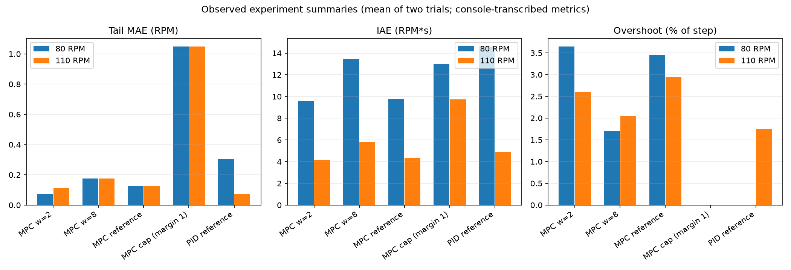
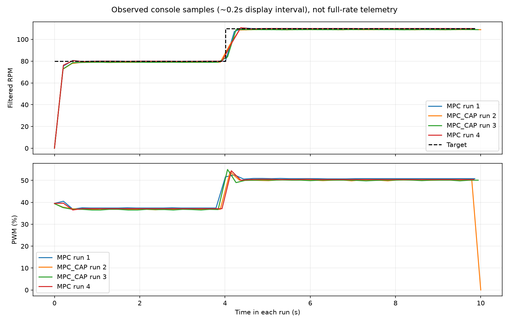

# 实机结果与如何读结论

这些结果来自课程形成过程中的参考样机；[数据来源](../data/observed/README.md)说明了公开记录的精度与缺失内容。公开版更换了通用显示素材和运行入口，控制实现沿用已测试版本；公开整理后的固件完成编译不代表每一节都重新做了一次实机实验。

## 编码器、速度与位置

排错的关键是共地：曾测到编码器蓝线对ESP32 GND约2.6V，确认连接后恢复为同一地。双路计数随后同时工作。每路约1400边沿/轮圈是本样机的校准值；课程提供重新校准脚本，不要求照抄。

120 RPM的5秒PI实验约0.4秒到125 RPM，随后缓慢收敛，结束前约120.3–120.5 RPM、PWM约50.3%。说明积分能消除静差，也说明起步超调与收敛速度有取舍；这不是完整频域稳定性证明。

Action位置目标3圈的示例最终编码器估计为3.008571圈，误差约+3.09°，落在当时5°容差内。编码器估计不等于独立外部测量的真实轮子角度。取消顺序是请求停止、ESP32确认驱动关闭、Action报告CANCELED；驱动关闭后仍可能滑行。

## 模型验证

辨识使用阶跃PWM与板端时间戳，将前段训练与后段自由预测验证分开。终端记录给出的二阶模型为：

\[
y_k=0.886839y_{k-1}-0.148937y_{k-2}
 +0.397151u_{k-1}+0.194144u_{k-2}-0.952157
\]

这里`u`是PWM百分数（例如50，不是0.5），`y`是与辨识一致的滤波RPM。标称采样50ms；实际部署还需完整模型的采样检查。独立验证自由预测RMSE约0.40 RPM，一步预测RMSE约0.32 RPM，R²显示1.000是四舍五入，不代表完美模型。

稳态令所有`y`相同、所有`u`相同，可得`RPM≈2.256×PWM百分数−3.633`。它只描述稳态关系；MPC预测使用上面的动态模型，才能描述加减速滞后。模型在约30–55% PWM训练，对反转、启动死区、改变供电和负载不能直接外推。

## PID、普通MPC与约束MPC



图中每根柱是相同条件下两轮的均值；求解时间取日志最大值，PID不报告MPC求解时间。统计来自程序当时打印的高频记录分析结果，而非下面的稀疏显示曲线。

| 实验 | 80 RPM尾部MAE | 110 RPM尾部MAE | 最大求解时间 |
|---|---:|---:|---:|
| 普通MPC，权重2 | 0.075 RPM | 0.110 RPM | 0.570ms |
| 普通MPC，权重8 | 0.175 RPM | 0.175 RPM | 1.098ms |
| 约束比较中的普通MPC | 0.125 RPM | 0.125 RPM | 0.604ms |
| 预测约束MPC，1RPM余量 | 1.050 RPM | 1.050 RPM | 2.716ms |

提高输入变化权重抑制激烈调节，但这次没有在所有阶跃上消除超调。加入预测转速上界后，两轮记录的80/110 RPM阶段均未观察到滤波RPM超过目标，预测约束最大违反打印为0。它通过保留约1RPM余量实现，因此稳定值约78.9/108.9 RPM；MAE变大是设计取舍。



上图仅用公开终端样本重绘，不是完整50ms记录。不能据此证明两次显示之间从未出现尖峰。2.716ms约占50ms周期的5.43%，只计算求解器耗时，不是全部任务CPU占用，也不是最坏执行时间保证。

硬约束限制的是**模型预测**。模型失配、外界扰动、采样延迟、滤波会导致真实转速不同；1RPM余量并非经过最坏情况证明的鲁棒边界。不可行、超时或数值失败时控制器停机，不通过静默放松约束继续转动。

## 自己复现

按[第19节](../lessons/19-identification/README.md)生成自己的模型，再运行[第20节](../lessons/20-mpc-comparison/README.md)和[第21节](../lessons/21-constrained-mpc/README.md)。保持供电、负载、目标、初始状态、采样和实验时长一致，并交换算法运行顺序。

重新生成本页图表：

```bash
python tools/plot_observed_results.py
```

课程没有把讨论过的micro-ROS、FreeRTOS系统课程、LQR或IMU实验算作已完成。
